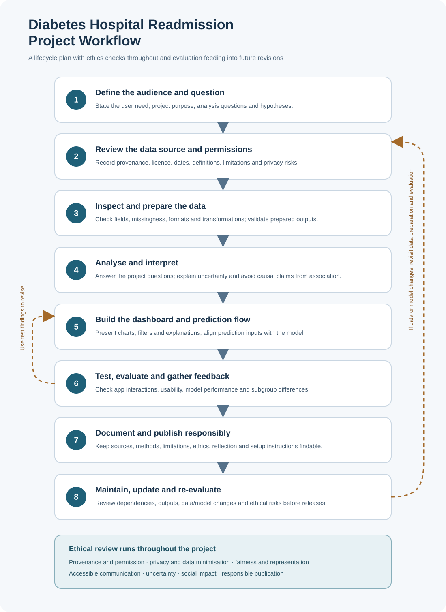

# 🏥 Diabetes Hospital Readmission Analysis and Prediction

**Using data analysis and machine learning to explore hospital readmissions among patients with diabetes.**

https://codeinstitute.s3.amazonaws.com/fullstack/ci_logo_small.png

## Audience

This project is for hospital quality-improvement and discharge-planning teams, as well as data analytics learners. It helps them explore historical patterns in readmission records. It is not intended to guide care for individual patients.

## Purpose

I use historical hospital records for patients with diabetes to explore which encounter characteristics are associated with readmission within 30 days. The aim is to communicate patterns clearly and responsibly, while showing the limits of older observational data and experimental modelling.

## Main question

Which patient and hospital-encounter characteristics are associated with a recorded readmission within 30 days?

## Analysis questions

1. How does the 30-day readmission rate vary across age groups?
2. Does average hospital-stay length differ between records with and without a 30-day readmission?
3. Is having a prior inpatient visit associated with 30-day readmission?
4. Is a recorded diabetes medication change associated with 30-day readmission?

## Hypotheses and findings

These tests examine associations or differences in the historical dataset. They do not show that a factor caused readmission.

- **H1 — Prior inpatient visits:** Records with at least one prior inpatient visit will have a different 30-day readmission outcome from records with no prior inpatient visit. The saved chi-square test output reports a statistically significant association (p < 0.001), with a small effect size (Cramér’s V = 0.0817).

- **H2 — Hospital-stay length:** Average hospital-stay length will differ between records with and without a 30-day readmission. The saved Welch’s t-test output reports mean stays of 4.79 days and 4.22 days, respectively (p < 0.001), with a small effect size (Cohen’s d = 0.1956).

- **H3 — Medication changes:** A recorded diabetes medication change will be associated with 30-day readmission. The saved chi-square test output reports a statistically significant association (p < 0.001), with a very small effect size (Cramér’s V = 0.0145).

A low p-value does not by itself show that an effect is large, clinically important or useful for prediction. These results do not establish causation or the accuracy of predictions for an individual.

## Success criteria

- The dashboard answers the main question using clearly labelled measures and charts.
- Readmission rates use a clearly stated denominator and the `readmitted_30` outcome.
- Each hypothesis is assessed with an appropriate comparison, and the result is described without causal claims.
- The intended audience, data limitations and non-clinical purpose are clear to a first-time user.

## Dataset Source, Coverage and Limitations

### Source and licence

I used the *Diabetes 130-US Hospitals for Years 1999–2008* dataset from the [UCI Machine Learning Repository](https://archive.ics.uci.edu/dataset/296/diabetes-130-us-hospitals-for-years-1999-2008).

**Citation:** Clore, J., Cios, K., DeShazo, J., & Strack, B. (2014). *Diabetes 130-US Hospitals for Years 1999–2008* [Dataset]. UCI Machine Learning Repository. [https://doi.org/10.24432/C5230J](https://doi.org/10.24432/C5230J).

UCI lists the dataset under a [CC BY 4.0 licence](https://creativecommons.org/licenses/by/4.0/). I include this attribution so users can trace the source and licence.

### Coverage and contents

The source data covers hospital records from 130 US hospitals and integrated delivery networks between 1999 and 2008. It includes demographic, diagnosis, medication, laboratory, hospital-stay and previous-visit information. The source dataset contains 101,766 records. After the filtering and deduplication described in my ETL notebook, the processed file contains 69,990 rows and 47 columns, with one retained encounter per patient.

### Limitations

This is historical US hospital data. It may not reflect current practice, other health systems or people who were not admitted to hospital. The analysis also excludes certain discharge outcomes and retains only one encounter per patient, so its results apply to the resulting cohort rather than every patient with diabetes.

The source data contains missing values. My ETL process handles some missing-value markers and fills selected categorical fields, but blank laboratory-result values remain in the processed file and need further review.

The processed file retains unique encounter and patient numbers. These identifiers are excluded from the model features in the feature-engineering notebook, but remain in the published data file. Their necessity should be reviewed before further public sharing or use in dashboard exports.

The findings describe patterns in observational records. They do not establish that a feature causes readmission and should not be used to make decisions about individual patients.

### Data cleaning review

The data-cleaning notebook replaces ? with missing values and fills selected fields, including race, medical specialty, and diagnosis fields, with Unknown. Missing results remain in max_glu_serum and A1Cresult; therefore, the README should not say that all rows with missing values were removed. The cleaned dataset also retains patient_nbr and encounter_id. These identifiers are excluded from the model features, but they remain in the processed file and need careful handling when sharing or displaying data.

The cleaning process removes duplicate patients after using patient_nbr, excludes selected discharge-disposition records, and drops weight, payer_code, examide, and citoglipton. These choices can affect which patients and information are represented in the analysis. I will document their reasons and limitations, and check that any future changes to cleaning are reflected consistently in the analyses, model, visualisations, and dashboard.

### Prediction feature review

The Streamlit prediction form now uses the same six features as its dedicated model: time in hospital, number of medications, prior inpatient visits, prior outpatient visits, prior emergency visits and number of lab procedures. The decision threshold is selected using validation data. On the held-out test data, the model achieved ROC-AUC 0.583, precision 0.120 and recall 0.413, with a readmission rate of 0.090. These results show limited predictive performance. The displayed probability is for educational analysis only and should not guide decisions about individual patients.

### Model performance and fairness review
The six-input model achieved ROC-AUC 0.583, precision 0.120 and recall 0.413 on held-out test data. Its readmission rate in that test set was 0.090. This indicates limited predictive performance: at the selected threshold, the model identified some readmissions, but many cases it flagged were not readmitted.

I also compared recall and precision across age, race and gender groups in the test data. Results varied between groups. For example, recall ranged from 0.273 for records with race recorded as Unknown (350 records) to 0.545 for records in the Other race category (230 records). Female and male recall was 0.429 and 0.395, respectively. Group sizes differ, and some are small, so these figures do not establish that the model is fair or biased. They show why performance should be monitored across groups and why this model must not be used to make decisions about individual patients.

 ### Usability review and prediction check

An external reviewer opened the app and understood its purpose without explanation. They used the age filter and saw the dashboard update, understood the readmission chart and table, used the filters, and downloaded the CSV. They reported that these parts were clear.

Separately, I checked the patient simulator using its default inputs. It displayed an estimated probability of 59.7%, above the model’s validation-selected threshold of 0.52. This check confirms that the simulator returned an output for that example; it does not establish prediction accuracy for an individual patient.

## Ethical Practice and Practical Reflection 

The detailed report covers ethical, privacy, legal and social considerations, along with the practical reflection: 
* Read the full report in [Ethical Practice and Practical Reflection](docs/ethics/ethics_and_reflection.md)

## Project Plan and Workflow (LO3.1)

[Project plan](docs/project_plan.md)

## Project Reflection

The practical challenges, changes, feedback, lessons learned and future improvements are documented in the [Ethical Practice and Practical Reflection report](docs/ethics/ethics_and_reflection.md).

### AI assistance:
 ChatGPT/Codex helped review the project, revise documentation, prepare the workflow diagram and troubleshoot the prediction app and model. I reviewed the suggested changes and I am responsible for understanding and verifying the work I submit.

