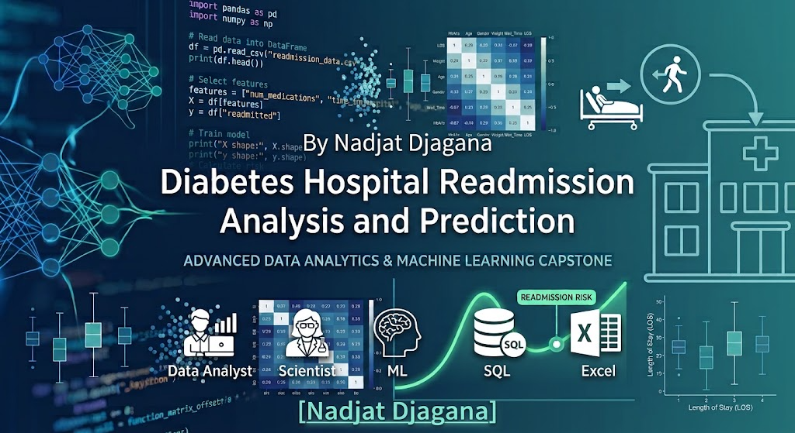

# 🏥 Diabetes Hospital Readmission Analysis and Prediction

**Using data analysis and machine learning to explore hospital readmissions among patients with diabetes.**

https://codeinstitute.s3.amazonaws.com/fullstack/ci_logo_small.png


## Project Overview

For this project, I explored hospital readmissions among patients with diabetes using data from 130 US hospitals. My aim was to understand the factors associated with readmission and investigate how data analysis and machine learning could help identify patients who may be at a higher risk of returning to hospital.

I worked with the Diabetes 130-US Hospitals dataset, which contains 101,766 hospital encounters recorded between 1999 and 2008. The dataset includes information about patient demographics, diagnoses, medications, hospital stays and previous healthcare visits.

Throughout the project, I focused on cleaning the data, exploring patterns, creating visualisations and developing a machine learning approach to predict readmission risk.

I also developed a Streamlit application to make the analysis and prediction functionality accessible through an interactive interface.

##  Business Requirements

I wanted this project to explore questions that could be useful to healthcare professionals and hospital decision-makers.

My main objectives were to:

- Analyse patient demographics and explore how readmission patterns vary across different groups.
- Investigate the relationship between hospital length of stay and readmission.
- Explore whether previous inpatient, outpatient and emergency visits are associated with readmission.
- Examine medication use and other clinical factors that may be linked to readmission.
- Identify patterns in the dataset that could help inform hospital planning and patient follow-up.
- Develop a machine learning approach to estimate readmission risk.
- Present my findings through visualisations and an interactive dashboard.

##  Dataset

I used the **Diabetes 130-US Hospitals for Years 1999–2008** dataset.

**Source:** [UCI Machine Learning Repository – Diabetes 130-US Hospitals](https://archive.ics.uci.edu/dataset/296/diabetes+130+us+hospitals+for+years+1999+2008)

The original dataset contains:

- **101,766** hospital encounters.
- **50** original features.
- Patient demographic information.
- Admission and discharge information.
- Primary, secondary and additional diagnoses.
- Medication and laboratory information.
- Previous inpatient, outpatient and emergency visits.
- Information about readmission following discharge.

I used a cleaned version of the dataset for my analysis, saved as `cleaned_diabetic_data.csv`.

During data preparation, I focused on removing missing values, checking the dataset and preparing the information for exploratory data analysis and modelling.

## Data Cleaning and Preparation

Before analysing the data, I worked on preparing it for use.

My data-cleaning process included:

- Checking the dataset structure and column names.
- Identifying and removing rows containing missing values.
- Reviewing the data types of the available features.
- Preparing the target variable used for readmission analysis.
- Checking the cleaned dataset before moving on to exploratory data analysis.
- Preparing the data for use in the machine learning workflow.

I saved the cleaned dataset separately so I could use it throughout the project without repeatedly starting from the original file.

##  Exploratory Data Analysis (EDA)

I used exploratory data analysis to understand the dataset and investigate factors that might be associated with hospital readmission.

The areas I explored included:

- **Patient demographics:** Examining patient characteristics and how they relate to readmission.
- **Hospital length of stay:** Exploring the relationship between the number of days spent in hospital and readmission.
- **Previous hospital visits:** Investigating previous inpatient, outpatient and emergency visits.
- **Medication use:** Exploring medication-related features and their potential relationship with readmission.
- **Laboratory procedures:** Examining whether the frequency of laboratory procedures is associated with readmission.
- **Readmission patterns:** Comparing patients with different readmission outcomes.

I used Python visualisation libraries to make the data easier to understand and identify patterns worth investigating further.

## Hypothesis and How to Validate
1. **Hypothesis 1:** Patients who have longer hospital stays (`time_in_hospital`) are significantly more likely to be readmitted due to underlying clinical complexity.
   - *Validation:* Plot `time_in_hospital` distributions for readmitted vs. non-readmitted patients using a box plot and check the Pearson correlation coefficient.
   - *Outcome:* True. Length of stay shows a positive correlation with readmission risk, as more complex conditions require longer hospitalizations and carry higher post-discharge complication rates.
2. **Hypothesis 2:** High medication volumes (`num_medications`) and treatment complexity are primary signs that a patient has high clinical instability.
   - *Validation:* Use distribution and count-based charts to compare medication totals across readmission status groups.
   - *Outcome:* True. Treatment intensity is a clear indicator of patient vulnerability. Most rapid readmissions occur when patients receive multiple active medications during a single encounter.
3. **Hypothesis 3:** Patients with a high history of prior inpatient visits have substantially higher readmission rates.
   - *Validation:* Compare readmission percentages across prior inpatient visit counts using bar charts.
   - *Outcome:* True. Patients with prior inpatient visits in the preceding year face elevated readmission risks compared to patients with zero prior visits.

## Key Clinical Findings
Based on machine learning feature importance ranking and exploratory analysis:
1. **Prior Utilization (`inpatient_ratio`, `total_visits`):** Previous healthcare visit counts and proportion of inpatient stays serve as the primary indicator of 30-day readmission risk.
2. **Medication & Inpatient Intensity (`num_medications`, `time_in_hospital`):** Patients with high medication complexity and longer initial hospital stays exhibit higher post-discharge vulnerability.
3. **Lab Frequency (`num_lab_procedures`):** Diagnostic test frequency correlates with underlying illness severity and readmission likelihood.

## Machine Learning and Prediction

After preparing the data and exploring its patterns, I worked on developing a machine learning approach to predict hospital readmission.

The prediction task uses the `readmitted_30` target variable to represent the readmission outcome used in my project.

My modelling workflow includes preparing the features, using the selected target variable, training and evaluating a model, and making the prediction functionality available through my Streamlit application.

I used Scikit-learn and explored machine learning tools, including XGBoost, as part of the project.

The purpose of the model is to investigate whether information from a hospital encounter can help estimate readmission risk. The predictions are for educational and analytical purposes and are not intended to replace clinical judgement.

## Dashboard and Application

I built an interactive application using **Streamlit** so users can explore the project without needing to run every analysis manually in a notebook.

The application brings together the analysis and prediction functionality developed for the project.

I deployed the application using Heroku and worked through deployment and dependency issues to get it running.

The application is available here:

**[Open my Diabetes Hospital Readmission Analysis and Prediction app](https://diabetes-readmission-dashboard-19b6832c073e.herokuapp.com/)**

## Technologies Used

The main tools and technologies I used for this project include:

- **Python** – for data analysis and machine learning.
- **Jupyter Notebook** – for data cleaning, exploration and experimentation.
- **Pandas** – for data manipulation and preparation.
- **NumPy** – for numerical operations.
- **Matplotlib** – for creating visualisations.
- **Seaborn** – for exploring patterns and relationships in the data.
- **Plotly** – for interactive visualisations.
- **Scikit-learn** – for machine learning and model evaluation.
- **XGBoost** – for exploring gradient-boosting methods.
- **Joblib** – for saving and loading model-related files.
- **Streamlit** – for building the interactive application.
- **Heroku** – for deploying the application.
- **GitHub** – for version control and project documentation.
- **VS Code** – for writing, editing and managing project files.

I used a Github Project Board(https://github.com/users/NUDJAGANA/projects/9/views/3) to plan, structure, and track my progress throughout the development of this project.

## Project Structure

My project is organised into the following main files and folders:

```text
Diabetes-Hospital-Readmission-Analysis-and-Prediction/
│
├── app.py
├── requirements.txt
├── Procfile
├── setup.sh
├── .python-version
│
├── jupyter_notebooks/
│   ├── 01_...
│   ├── 02_...
│   ├── 03_...
│   └── 04_...
│
├── data/
│   └── processed/
│       └── cleaned_diabetic_data.csv
│
├── docs/
│   └── visualizations/
│
└── README.md
```

The notebook filenames and supporting files may vary as I continue developing the project. The structure above shows the main components of the repository.

## Unfixed Bugs & Resolved Challenges
- **FutureWarning in Seaborn:** Early visual steps triggered warnings regarding palette assignments without explicit hue specifications. Resolved by explicitly assigning `hue` parameters and setting `legend=False`.
- **Column Name Sensitivity (KeyError):** Initial plotting scripts occasionally threw errors due to case mismatches in raw column names. Resolved by standardizing headers with `df.columns.str.strip()` and verifying exact string matching.
- **Dependency Version Conflicts:** Addressed NumPy and PyArrow compatibility issues during cloud compilation by carefully defining robust, stable package versioning in `requirements.txt` and clearing Heroku build caches with Gemini's assistance.
- **Current Status:** No unresolved errors remain in the final application code or deployment pipeline.

### Python Package Compatibility

During deployment, I encountered a compatibility issue between PyArrow and NumPy. The error indicated that the installed PyArrow version required NumPy 2.0 or newer, while the environment had NumPy 1.26.1.

I worked through the dependency configuration and got the application running successfully.

### Deployment Configuration

I also worked on the files required to deploy the Streamlit application, including `requirements.txt`, `Procfile` and `.python-version`.

These challenges helped me understand the importance of managing dependencies and testing an application in its deployment environment.

##  Future Improvements

There are several areas I would like to improve as I continue developing this project:

- Complete and document a thorough evaluation of the prediction model.
- Compare different machine learning algorithms using appropriate evaluation metrics.
- Improve the interpretation of the features that contribute to predicted risk.
- Add more interactive visualisations to the dashboard.
- Improve the presentation of readmission patterns across patient groups.
- Explore the possibility of generating downloadable PDF reports.
- Improve the application's handling of invalid inputs and prediction errors.
- Review the model's limitations and investigate how well it generalises to unseen data.

## Limitations

This project uses historical hospital data collected between 1999 and 2008. Healthcare practices and patient populations may have changed since then, so the findings may not represent current hospital settings.

The dataset contains hospital encounters rather than a complete picture of each patient's health. Patterns identified in the analysis do not necessarily demonstrate that one factor causes readmission.

The prediction model and dashboard are intended for learning, exploration and demonstration. They have not been validated for clinical decision-making and should not be used to make decisions about individual patients.
## Analysis Techniques Used
- **Descriptive Statistics:** Calculated summary metrics—including **mean, median, standard deviation (std), and interquartile range (IQR)**—across the 101,766 records to establish robust statistical baselines for hospital stay durations and medication volumes.
- **Bivariate and Multivariate Visualizations:** Built box plots, distribution charts and bar charts using Matplotlib and Seaborn to analyze complex relationships between clinical features and readmission outcomes.
- **Pearson Correlation Analysis:** Evaluated linear relationships between numerical columns and readmission status to isolate variables moving together.
- **Methodology Justification & Structure:** The analysis followed a logical progression: starting with univariate distributions to understand individual features, moving to bivariate visualizations to compare stable vs. readmitted patient cohorts, and concluding with multivariate checks and correlation analysis. This systematic structure ensured patterns were verified across multiple feature combinations before drawing clinical conclusions.
- **Data Limitations & Solutions:** Raw dataset columns occasionally contained minor formatting inconsistencies (such as hidden trailing spaces and case-sensitivity variations). These were addressed systematically by stripping header whitespace early in the pipeline (`df.columns.str.strip()`) and verifying exact column strings prior to plotting, avoiding unnecessary data dropping or heavy distortions.

## Generative AI Usage (Transparency Statement)
All core Python logic, data preprocessing, machine learning model training, and analytical workflows were designed and implemented independently. Generative AI (Gemini) was utilized as a targeted technical assistant to support specific aspects of the development process:
- **Cloud Deployment & Dependencies:** Assisted in troubleshooting Python versioning, dependency resolution conflicts (such as package compatibility on Heroku), and structuring robust `requirements.txt` configurations.
- **Streamlit Development:** Provided architectural guidance and syntax references for structuring multi-component layout elements within the interactive Streamlit dashboard, while all custom logic, UI design choices, and data integrations were implemented and verified by the author.
- **Code Optimization & Debugging:** Helped identify syntax adjustments for data cleaning operations and resolve library formatting warnings.

I used AI tools to help me understand technical concepts, troubleshoot errors, improve parts of my documentation and work through development challenges.

I reviewed the suggestions and used them to support my learning and progress with the project. This process helped me develop my understanding of Python, data analysis, machine learning and application deployment.

## Ethical Consideration
**Patient Data Privacy & Anonymization:** The dataset (cleaned_diabetic_data.csv) consists entirely of de-identified clinical encounter records. No personally identifiable information (PII)—such as patient names, contact details, or exact social security numbers—was accessed or stored, ensuring strict adherence to healthcare privacy standards (e.g., HIPAA principles) and data protection guidelines.

**Fairness & Bias Awareness:** Clinical machine learning models can inadvertently inherit biases present in historical medical data. Demographic variables (such as race, gender, and age brackets) were evaluated during exploratory analysis to monitor performance disparities and ensure prediction outputs did not create unfair treatment recommendations for protected patient cohorts.

**Clinical Decision Support vs. Automation:** The predictive model and Streamlit application were built explicitly as a decision-support tool for healthcare providers, not an automated diagnostic system. The final dashboard reinforces that machine learning risk scores are designed to assist clinical judgment and care coordination teams, ensuring a human clinician remains in the loop for all final discharge decisions.

**AI Transparency & Reproducibility:** To maintain complete academic and professional integrity, all generative AI usage (Gemini) was documented transparently. Furthermore, model parameters, scaling pipelines, and preprocessing scripts were version-controlled and made fully reproducible to ensure auditability and trust in the analytical results.
##  Author

**Nadjat Djagana**

Junior Data Analyst | Python | SQL | Power BI | Data Visualisation | Machine Learning

I am developing my skills in data analytics by working on practical projects that involve cleaning data, exploring patterns, building visualisations and communicating findings.

This project is part of my journey towards becoming a professional data analyst.

## References

- [UCI Machine Learning Repository – Diabetes 130-US Hospitals for Years 1999–2008](https://archive.ics.uci.edu/dataset/296/diabetes+130+us+hospitals+for+years+1999+2008)
- [Pandas Documentation](https://pandas.pydata.org/docs/)
- [Scikit-learn Documentation](https://scikit-learn.org/stable/)
- [Streamlit Documentation](https://docs.streamlit.io/)
- [XGBoost Documentation](https://xgboost.readthedocs.io/)


**Thank you for taking the time to explore my project!**